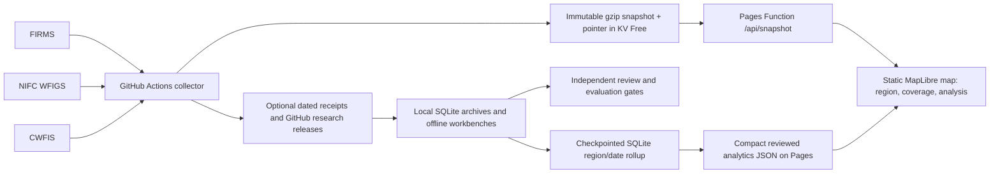

# Wildfire Signals roadmap

Evidence cut: 2026-10-14 UTC. `origin/main` was `b0506ab` when PR #58 safely combined #56 and #57; PR #58 CI passed, but remains unmerged. [PR #60](https://github.com/frogiraffe/wildfire-signals/pull/60) adds the offline historical foundation, [PR #59](https://github.com/frogiraffe/wildfire-signals/pull/59) adds the first environmental web pilot, [PR #61](https://github.com/frogiraffe/wildfire-signals/pull/61) adds satellite geolocation catalog context, [PR #62](https://github.com/frogiraffe/wildfire-signals/pull/62) adds the second real station pilot and web comparison, and [PR #63](https://github.com/frogiraffe/wildfire-signals/pull/63) adds paired active-fire product catalog context, stacked in that order. **Completed** means implemented and covered by tests; it does not mean deployed, scientifically validated, or reliable at every location. Current deployment state requires a fresh live check.

## 1. Product North Star

Help a person locate thermal signals and official incident reports, understand their source and time, investigate historical change, and eventually use independently validated forecasts. The map must keep `satellite_candidate`, `agency_incident`, possible identity links, environmental context and predicted outcomes distinct. No source silence is evidence of no fire.

## 2. Current State — evidence-backed gap analysis

The public service uses a static MapLibre map on Cloudflare Pages, a Pages Function reading an immutable gzip snapshot from Workers KV Free, and a GitHub Actions collector for two NASA FIRMS VIIRS feeds plus NIFC WFIGS and CWFIS. On 2026-10-13 at 20:05 UTC, [the collector run](https://github.com/frogiraffe/wildfire-signals/actions/runs/38460001197) completed with 105,726 **candidate cell-hour records in the rolling snapshot**, 441 **current agency records**, and no reported provider errors. Those are two different record kinds, not 106,167 confirmed fires. The run's denominator is one published snapshot and four configured provider feeds; it says nothing about independent detection accuracy. The latest checked [coverage CI run](https://github.com/frogiraffe/wildfire-signals/actions/runs/38334852620) succeeded on 2026-10-13 at 02:00 UTC. Recent source collection success does not prove interval continuity or current Pages/KV health. Direct Pages API access from this work environment timed out; Cloudflare Free status is not freshly independently observed here. The last checked [Free verification workflow](https://github.com/frogiraffe/wildfire-signals/actions/runs/38289991416) succeeded on 2026-10-12, but is historical evidence only.

The original local checkout has extensive unrelated uncommitted work and remains untouched. PR #56 and #57 were fetched and combined without conflicts on an isolated branch; [PR #58](https://github.com/frogiraffe/wildfire-signals/pull/58) targets main and remains open. This analytics slice uses a second isolated worktree based on #58. Source and test contracts, not older README completion claims, drive the inventory below.

The largest immediate product gap in Priority A was that the regional panel conflated a zero **within a circle** with an empty **provider response** and presented global product age beside regional counts. The branch adds response count/state and separates regional last observation from global age. It does not prove acquisition completeness.

## 3. Capability Inventory

| Capability | Status | Current evidence and limit |
|---|---|---|
| FIRMS NOAA-20/21 candidate collection | Completed | `fire_public/collect.py`, `tests/test_collect.py`; rolling 72-hour 0.05°/UTC-hour candidates, not fires. |
| NIFC WFIGS and CWFIS current incidents | Completed | Collector and parsing tests; source-defined current layers, not global event truth. |
| Global source coverage audit and map panel | Partial | `public/coverage-audit.mjs`, `region-explorer-view.mjs`, browser tests. This slice adds empty response evidence; geography-specific acquisition opportunity and empirical coverage remain unmeasured. |
| SQLite historical FIRMS and agency evidence | Experimental | `pixel_history.py`, `history.py`, `receipt_history.py`, release synchronization and tests support bounded offline replay; no public global long-term service. |
| Historical Intelligence Workbench and change explorer | Experimental | Offline HTML/JSON tools and tests exist; not a hosted date-range map. |
| SHA-256 source receipts, label review, coverage gate | Experimental | Evidence archive, two-reviewer workflow and negative-window gates have tests; no independent global evaluation cohort established. |
| NIFC–MTBS–CAL FIRE identity research | Experimental | Candidate reviews, 14-pair and 18-page pilots; proximity and shared upstream sources do not prove identity. |
| Time-of-availability checks | Partial | Decision-time and prospective receipt modules reject late inputs in tests; not applied to every environmental or historical feed. |
| Environmental context | Partial | US on-demand NWS grid/perimeter context and local pilots; no complete timestamped terrain/fuel/weather pilot for one event. |
| Descriptive regional analysis | Experimental | Browser statistics and offline research reports operate on real evidence, without validated fire outcome interpretations. |
| Incremental original-pixel analytical rollup | Experimental | Same SQLite DB, per-scan atomic checkpoints, bounded fetches and indexed date/region queries; 2,000,001-row synthetic scale test measured. Research branch only. |
| Historical station context in analytics page | Experimental | Two real NOAA GHCNh station files (Batman and Sacramento) joined to FIRMS candidate hours, with missingness, SHA-256, units, provenance and web selection. Four and five candidate hours respectively have matched temperature; no weather association is supported. |
| Three-year Antalya standard archive and station context | Experimental | Six NASA FIRMS 2023–2025 country CSVs and three NOAA GHCNh station-year files, hash-pinned and deterministically joined. 1,340 selected pixels and 994 positive sensor-hours, 988 with prior station temperature. Month/sensor/variable UI and downloadable aggregate; acquisition exposure, decision-time availability and independent fire outcomes remain unknown. |
| Two-region annual archive comparison | Experimental | Dalaman was chosen from the official GHCNh station list before thermal count inspection, then used the same six NASA files and three new station-year files. 79 Dalaman pixels and 38 positive sensor-hours, all with prior temperature. Region/year selection and source denominators in the existing analytics page; neither site has verified no-detection exposure. |
| Spatial recurrence and source quality | Experimental | Six original FIRMS files were reprocessed into bounded 0.01° bins for Antalya and Dalaman. Two Antalya bins meet a transparent potential-static review cue, but no independent source identity or wildfire outcome is claimed. Confidence, source type and day/night by year are visible in the analytics page. |
| Standard VIIRS acquisition and outcome readiness | Experimental / blocked for cell-level evidence | A two-day NOAA-20 Antalya audit pairs six real L1/L2 standard granule catalog intervals with one archived candidate minute; a following date has no archived record and unknown acquisition. Anonymous granule content requests returned 401. No independent positive/negative wildfire outcome cohort or occurrence model is supported. |
| NOAA-20/21 CMR granule catalog context | Experimental | Offline bounded, SHA-256 checked L1 geolocation and L2 active-fire product queries, same-platform interval pairing, seven archived provider-minute comparisons and a browser evidence table. Twenty exact L1/L2 catalog pairs and five of seven candidate groups inside them in Batman; no file-content, cell-level opportunity or negatives. |
| Occurrence, spread, termination forecasting | Missing | Baseline research utilities exist, but independent labels, holdouts and calibration gates are unmet. No public probabilities. |
| Internationalized UI | Partial | English/Turkish map strings; source adapters and official event coverage vary by region. |

## 4. Product Architecture

The research modules are offline consumers of original receipts, not live map dependencies. Keep that boundary; avoid introducing a second hosted database until storage, rights, restore, and Free-budget evidence justify it. Current CLI modules are numerous; simplify entry points only when a concrete user workflow needs it. Source capability metadata appears in the browser registry, while collector statuses come from Python; reconcile these contracts before adding providers to prevent drift.

## 5. Phase Dependencies

Coverage and source-time integrity support both historical exploration and event timelines. A historical browser experience needs a bounded, reproducible release query and a storage plan first. Environmental analysis needs source license plus observation, issue, availability and valid times. A forecast needs an independent evaluation cohort for its exact target, geography and horizon. The UI should ship with each usable data slice, not as a final standalone phase.

## 6. Prioritized Milestones

| ID | Priority | Status | Objective | Existing components | Deliverables | Acceptance tests | Dependencies |
|---|---|---|---|---|---|---|---|
| A1 | P0 | Partial | Distinguish provider empty responses, regional observation time and global feed age in selected-circle map | Collector source rows; coverage audit; map panel | Response evidence in snapshot, panel and export | Empty vs failed vs zero-in-circle; region time; browser desktop/mobile; full tests | None |
| A2 | P0 | Missing | Measure source reliability and declared/actual scope over a bounded UTC interval | Collector receipts, region diagnostics, release archive | Per-provider attempt ledger and denominator, outage gaps, source/version/rights manifest | Replay real receipts with missing intervals and antimeridian/polar cases | A1, receipt availability |
| B1 | P0 | Partial | Explore one real historical region/date range in the web product | SQLite pixel history, research release sync, workbench | Bounded published historical query or static manifest plus date UI | Same query replay gives same hashes/counts; late receipts excluded; Free size gate | Rights and storage measurement |
| B2 | P0 | Experimental | Incrementally aggregate an archive beyond the bounded pilot | SQLite pixel history and release sync | Same-DB scan checkpoints and bounded region/date queries | Atomic interruption/recovery; duplicate and changed-history checks; measured >1M and 2M fixture | Verified source archives outside Git |
| C1 | P1 | Experimental | Show uncertain event identity and source revisions | Agency receipt time machine, NIFC–MTBS–CAL FIRE research | One evidence-linked timeline with hypothesis and dispute states | Mixed/split identity and correction cases; independent source check | Historical receipts |
| E1 | P1 | Partial | Complete one real environmental pilot | NWS and perimeter pilot, decision-time audit | One event report with weather, terrain and time provenance | Units, issue/valid/receipt time and missing-data tests | Source rights and chosen event |
| E2 | P1 | Experimental | Show genuine station context alongside archived thermal candidates in two geographies | FIRMS pixel receipts, GHCNh station files, B2 rollup | Batman and Sacramento joined aggregates, reports and region/variable-selectable browser view | SHA checks, observed-time joins, missingness, desktop/mobile, source provenance | B2; publication time remains unknown |
| E3 | P0 | Experimental | Explore a genuine multi-year thermal archive with station context | Existing FIRMS/GHCNh joins and static analytics page | Antalya 2023–2025 manifest, reproducible aggregate/report, month/sensor/weather UI | Exact source hash and byte replay, missingness and unknown exposure tests, desktop/mobile | Source revisions pinned; no independent swath/negative evidence |
| E4 | P0 | Experimental | Reuse the annual study in a second independently chosen geography | E3 annual builder and original country files | Dalaman source-hashed station join, scientific report and region/year browser comparison | Both report hashes replay, source/year denominators, missingness, desktop/mobile and CI | Same unknown satellite acquisition opportunity; no regional fire-rate claim |
| Q1 | P1 | Experimental | Audit spatial persistence and source quality before fire models | E3/E4 original source files, FIRMS attributes | Hash-pinned bin recurrence, year/source-quality report and browser view | Real replay, duplicate and overlap tests, source-classification gate, mobile/desktop CI | External static reference rights and independent event evidence |
| Q2 | P1 | Experimental; cell validation blocked | Audit standard VIIRS acquisition and model readiness | E3 Antalya archive, CMR standard products | Hash-pinned L1/L2 catalog pair, explicit two-day observation states, independent-outcome review, web view | Exact replay, hash and negative-promotion tests, browser checks | Authorized L1/L2 contents and independently supported dated/location outcome evidence |
| S1 | P1 | Experimental | Place FIRMS candidate minutes beside official satellite granule metadata | NASA CMR, FIRMS pixel rollup, Batman station pilot | Version-pinned NOAA-20/21 CMR snapshot, audit report and browser table | Real two-product queries, source hashes, provider/time join, unknown exposure, desktop/mobile | B2; actual granule arrays and product quality still missing |
| D1 | P1 | Experimental | Produce source-auditable descriptive historical report | Analysis engine and offline workbench | Region/event report with sampling and missingness | Real receipt replay, denominator and export review | B1, E1 where relevant |
| V1 | P1 | Blocked | Establish independently evaluable target cohort | Label review, receipt store, negative gate | Two-reviewer protocol, independent positive/negative evidence, holdouts | Source independence, coverage, leakage and disagreement gates | Suitable external observations and rights |
| F1 | P2 | Blocked | Compare occurrence/spread/termination baselines separately | Offline baseline/evaluation utilities | Target-specific baseline, calibration and limitations | Geographic/event/year holdouts and independent evaluation | V1 for each target |
| I1 | P2 | Partial | Expand countries, language and accessibility | EN/TR map, WGS84/antimeridian tests | Provider adapter contract and verified first new source | Polar/UTC/license/mobile keyboard tests | A2, source rights |
| O1 | P2 | Partial | Release safely on Free infrastructure | Actions, Pages/KV, Free gate, scheduler | Fresh health/cost dashboard, restore and security checks | Live CI/API/Cron, load, budget and rollback evidence | A1/B1 operational footprint |

**Milestone acceptance:** A milestone moves to Completed only when its listed behavior is implemented, tests pass in the relevant current branch, and any real-source or human-review gate is evidenced. A1 remains Partial because PR #58 has passed CI but has not been integrated into production-connected main. B2/E2 remain Experimental because the archive and station pilot do not establish complete observation opportunity, long-term retention or scientific associations. Phases 0–10 map respectively to architecture/operations, A, B, C, E, D, V, F, cross-cutting UI, I, and O.

## 7. Definition of Done per milestone

For every row: preserve source semantics, provide a user-visible workflow when applicable, test failure/empty/stale states, record actual source sample and denominator, measure storage/latency/cost, document limits, and pass the relevant CI gate. For A1 specifically, the exported audit must distinguish `returnedRecordCount=0` from `observedInCircle=0`, mark failed/deferred response counts unknown, and label regional vs global time. For B1, users must query a bounded date range without a terminal. For V1/F1, passing code tests alone is insufficient: independent evidence and calibration/holdouts are required.

## 8. Scientific Validation Gates

Keep observed candidate cell-hours, agency listings, event identity and negative windows separate. Require source-time receipts and as-of joins; do not use later corrections as prior inputs. Negative labels require demonstrated observation opportunity and independent review. For any predictive target, define event/region/time unit and horizon first, then independent positive and negative labels, event/year/geography holdouts, leakage audit, baseline comparison, calibration and error analysis. Mark unavailable where evidence is missing. Never infer burned area, intensity or wildfire frequency from pixel counts.

## 9. Data Source Coverage & Licensing

FIRMS world API requests provide thermal candidate data; a successful request is not full swath/acquisition coverage. NIFC WFIGS is a US current incident source, CWFIS a Canada current active-fire source. US NWS and perimeters are on demand and not monitored by the snapshot. Existing source/rights links are in `public/coverage-audit.mjs`; review exact reuse terms and version before durable redistribution or new layers. Europe/Türkiye official source reuse remains under audit. Do not infer a country boundary from the selected circle. Record provider endpoint, license, geographic claim, source and receipt times, corrections, response count and observed footprint separately.

## 10. Operational and Cost Constraints

Keep Pages, Functions, KV and Worker Cron on Free, with fail-closed subscription checks; no R2, paid plan, large runner or new secret assumed. Immutable gzip snapshots are capped at 5 MiB and expire after seven days. Research releases and local SQLite archives are separate from the live KV map. Adding one integer per four source rows has negligible expected payload impact, but measure actual gzip size and browser load before integration. GitHub scheduled runs may be delayed or skipped; a green run is not an uptime denominator. No local Docker is required.

## 11. Risks and Open Questions

- Live Pages API and Cloudflare quota/plan could not be independently read from this environment at the evidence cut; do not claim production health or current Free consumption from CI alone.
- Collector status is per request, while selected-circle counts and time are per region. Neither gives a satellite observation-opportunity denominator.
- Historical releases and 90-day Actions artifacts have retention, replay and restore limits. Verify original bytes and license before a hosted historical product.
- NIFC/MTBS/CAL FIRE may share upstream records; research candidates are not independent labels.
- Many small CI workflows duplicate setup and dependency downloads. Measure runner minutes and wall time before consolidation; do not weaken gates solely to reduce jobs.
- Repo policy, source registry and README should be reviewed for license URL specificity. Static capability entries may drift from collector providers.

## 12. Next Executable Tasks

1. Review PR #58, #60, #59, #61 and #62 in stack order; merge into production-connected main only with explicit authorization and fresh live/Free checks.
2. Extend B2 with a tested restore/migration exercise and a predeclared second archive period. Keep originals and SQLite backups outside Git; publish only bounded reviewed aggregates.
3. Obtain authorized access to one bounded original VIIRS 375 m geolocation granule and its active-fire product, then inspect cell geolocation and quality. NASA LANCE redirects anonymous downloads to Earthdata login; metadata search hits remain `unknown` cell opportunity and no negative labels.
4. Investigate authentic VIIRS swath/quality and independently documented fire outcome evidence for the same 2023–2025 units. A catalog interval or recurrence bin alone is not a negative observation or physical event.
5. Design a reproducible model-readiness cohort only for units with verified observation and outcome evidence; otherwise keep archived activity descriptive.
5. Continue A2 provider reliability ledger from real collector receipts, separate from satellite exposure.

## 13. Decision Log and Progress Tracking

| Date | Decision / progress | Evidence |
|---|---|---|
| 2026-10-13 | Build from latest `origin/main` in an isolated worktree; preserve the dirty older checkout | Git status and `b0506ab` head at cut |
| 2026-10-13 | Prioritize provider response emptiness plus regional/global time separation; retain existing map and snapshot contract | A1 tests, `collect.py`, `coverage-audit.mjs`, `region-explorer-view.mjs` |
| 2026-10-13 | Keep regional completeness unverified; do not turn zero or a successful request into a negative fire label | Coverage audit flags and acceptance tests |
| Pending | Production main merge and live Pages/KV/Free verification remain separate from open PR CI | Explicit authorization and fresh checks required |
| 2026-10-14 | Combined open #56 and #57 into non-production [PR #58](https://github.com/frogiraffe/wildfire-signals/pull/58); integrated Python, JS and browser checks passed; PR checks green | Integration commits `ab24e5b`, `1705d64`, `6ace19c`; PR status |
| 2026-10-14 | Kept existing SQLite; added per-scan checkpointed aggregate and synthetic 1M/2M scale benchmark | `historical_rollup.py`, test suite and benchmark output; no performance fixture presented as observations |
| 2026-10-14 | Selected Batman after checking overlapping real FIRMS and GHCNh records; produced source-hashed retrospective station context | [scientific report](research/batman-station-thermal-context-2026-10.md), joined JSON, frontend and tests; only four temperature-matched candidate hours |
| 2026-10-14 | Added a second real station/context pilot and browser site comparison; kept observed candidates separate from exposure and weather inference | [Sacramento scientific report](research/sacramento-station-thermal-context-2026-10.md), source-hashed JSON, replay, Python/JS/browser tests; five temperature-matched candidate hours |
| 2026-10-14 | Built a bounded three-year Antalya standard-processing FIRMS/GHCNh retrospective archive with explicit positive-only observation state and web exploration | [PR #64](https://github.com/frogiraffe/wildfire-signals/pull/64), [Antalya scientific report](research/antalya-annual-thermal-weather-2023-2025.md), nine-file manifest, byte-identical replay, tests; no independent wildfire or negative-exposure model |
| 2026-10-14 | Selected Dalaman from official GHCNh list before thermal-count inspection; reused six NASA originals and added three station files for a second genuine annual study | [PR #65](https://github.com/frogiraffe/wildfire-signals/pull/65), [Dalaman scientific report](research/dalaman-annual-thermal-weather-2023-2025.md), pinned manifest, byte-identical aggregate, region/year browser tests; no regional fire-rate or wildfire-model claim |
| 2026-10-14 | Reprocessed the same six NASA originals for coarsened spatial recurrence and source-quality evidence without promoting repeated pixels to event identities | [PR #66](https://github.com/frogiraffe/wildfire-signals/pull/66), [spatial scientific report](research/turkey-spatial-recurrence-2023-2025.md), source-hashed JSON, browser evidence table and tests; NASA static mask not redistributed |
| 2026-10-14 | Audited two days of NOAA-20 standard L1/L2 catalog evidence and independent wildfire outcome readiness without creating false negative observations | [standard product scientific report](research/antalya-standard-viirs-model-readiness-2025-01.md), hash-pinned source snapshot and browser evidence states; PR #67 pending review. Cell contents require authorized access and outcome cohort remains absent |
| 2026-10-14 | Attempted a bounded original NOAA-20 geolocation/active-fire granule download; anonymous GET returned Earthdata login HTML despite metadata/HEAD availability | [NASA LANCE help](https://nrt3.modaps.eosdis.nasa.gov/help/), Sacramento report access audit; actual cell opportunity remains unknown |
| 2026-10-14 | Split the scientific/operational risks into stacked review branches | [#60](https://github.com/frogiraffe/wildfire-signals/pull/60) targets #58's integration branch; [#59](https://github.com/frogiraffe/wildfire-signals/pull/59) targets #60's foundation branch; main is untouched |
